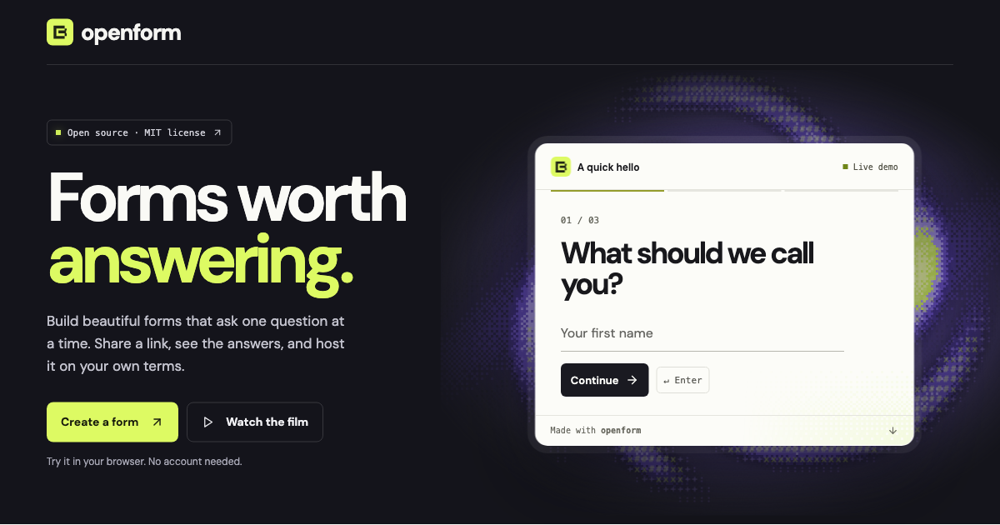

# Openform

**Forms worth answering.**

[Try the interactive demo](https://arjunkshah12345-hash.github.io/openform/) · [Watch the launch film](https://arjunkshah12345-hash.github.io/openform/media/openform-launch.mp4) · [Self-hosting guide](https://arjunkshah12345-hash.github.io/openform/guides/self-host-conversational-forms.html)



A friendly, open-source alternative to Typeform. Build forms, share a conversational one-question-at-a-time experience, and keep your responses in your own SQLite database.

## Run locally

Requires **Node.js 22.13 or newer** and npm. Node's built-in SQLite driver is used; some Node releases print an experimental SQLite warning.

```sh
npm install
npm run dev
```

Open http://127.0.0.1:5173. Vite runs on port 5173 and proxies `/api` to the Express server on port 3001. A fresh database includes six editable example forms and no example responses.

## What works

- Workspace with form search, sorting, grid/list layouts, and draft/published filters.
- Form builder with text, long text, email, multiple choice, rating, number, and yes/no questions.
- Form themes, previews, publishing, duplication, trash and restore.
- Shareable `/f/:id` forms with required-field and server-side answer validation.
- Response viewing and CSV export.
- SQLite persistence, an MIT license, and Docker support.

## Production / self-hosting

```sh
npm run build
npm start
```

The server serves both the built frontend and API at http://127.0.0.1:3001. Configure `HOST`, `PORT`, and `DATABASE_PATH` through environment variables. Defaults are `127.0.0.1`, `3001`, and `data/openform.sqlite`.

```sh
docker compose up --build -d
```

Docker exposes the app at http://127.0.0.1:3001 and stores data in the `openform-data` volume.

**Deployment model:** this version is a single-owner workspace without a login system. Keep it bound to localhost for personal use. Before exposing it on a public domain, put authentication at your reverse proxy in front of the workspace and all `/api/forms` routes. Allow respondents to access `/f/*`, `/api/public/forms/*`, and static assets. Use HTTPS. Everyone who can access the administrative routes can view, modify, and delete all forms and responses. Published form links are accessible to anyone who has the link; draft and trashed forms are unavailable through the public API.

## Data and backups

SQLite creates `data/openform.sqlite` and its WAL/SHM companions. The data directory is ignored by Git and survives application restarts. Back up the database with SQLite's backup command, or stop the server before copying the entire data directory. Do not copy only the main file while the server is writing.

Each new submission stores a snapshot of the questions, so changing or deleting a question keeps its original title and type available in historical responses. Databases from earlier versions migrate automatically; older submissions without snapshots use the current form questions. Permanently deleting a form also deletes its responses.

## Development

```sh
npm test              # 7 API lifecycle, validation, persistence and production checks
npm run test:demo     # 4 browser-local adapter and sharing checks
npm run build        # TypeScript checks and self-hosted production build
npm run build:pages  # GitHub Pages demo build under /openform/
```

- `src/`: React + TypeScript frontend.
- `server/app.mjs`: Express API and production static serving.
- `server/db.mjs`: SQLite schema, initial examples and serialization.
- `server/index.mjs`: process entry point.

### API

Administrative endpoints return JSON and are intended for the owner:

| Method             | Route                             | Purpose                                            |
| ------------------ | --------------------------------- | -------------------------------------------------- |
| GET / POST         | `/api/forms`                      | List / create forms                                |
| GET / PUT / DELETE | `/api/forms/:id`                  | Read / update / permanently delete                 |
| POST               | `/api/forms/:id/duplicate`        | Copy as a draft                                    |
| GET                | `/api/forms/:id/responses`        | Read stored submissions                            |
| GET                | `/api/public/forms/:id`           | Read a published, active form                      |
| POST               | `/api/public/forms/:id/responses` | Submit `{ "answers": { "question-id": "value" } }` |

PUT accepts partial form fields. Trash and restore use `{ "trashed": true }` and `{ "trashed": false }`. Answer keys are question IDs. Rating answers are integers 1–5; yes/no answers are `Yes` or `No`. Error responses use `{ "error": "message" }`.

## Contributing

Open a focused issue or pull request. Include reproduction steps for bugs and run `npm test` and `npm run build` before submitting changes. Keep the form builder keyboard accessible, honor reduced motion, and avoid external services for core functionality.

## License

MIT. Openform is an independent project and is not affiliated with Typeform.

## GitHub Pages interactive demo

The public website can run entirely on GitHub Pages, with no database or API server:

```sh
VITE_STATIC_DEMO=true VITE_BASE_PATH=/openform/ npm run build
```

The included `.github/workflows/pages.yml` runs the API and demo tests, builds the static site, and deploys the `dist` directory when a commit reaches `main`. In repository **Settings → Pages**, select **GitHub Actions** as the build source. Set `VITE_BASE_PATH=/` when deploying to an account root or custom domain instead of a project subpath.

The landing page lives at the deployment root. The demo workspace uses `#/workspace`, editors use `#/forms/:id/edit`, and published forms use `#/f/:id?form=…`; hash routes work on direct links and refreshes without a server fallback.

**The Pages app is an interactive demo, not a hosted response collection service.** Forms and answers are saved in that browser’s local storage. Shared demo links contain an immutable snapshot of the published form, so they open in another browser; they cannot be revoked by unpublishing the local original. Answers submitted in another browser stay there and are not transmitted to the form owner. Do not put private questions or personal data in demo links. Use the normal SQLite-backed build to collect responses centrally.

Run the static adapter checks with:

```sh
node --test src/static-store.test.mjs
```

The default `npm run build` keeps the self-hosted API behavior. Demo mode is enabled only when `VITE_STATIC_DEMO=true` is provided at build or Vite startup time.

## Launch film and source

The original 30-second motion film is built with Remotion. Editable compositions, original synthesized audio, and render commands are in [`video/`](video/README.md). The website includes a lightweight landscape MP4 and a caption track. The local render folder also contains a portrait export. Fonts are locally bundled and OFL licensed. Launch drafts and the source-informed discovery plan are in [`launch/`](launch/README.md); no script publishes or schedules social posts.

See [CONTRIBUTING.md](CONTRIBUTING.md) and [SECURITY.md](SECURITY.md) before deploying or submitting changes.
